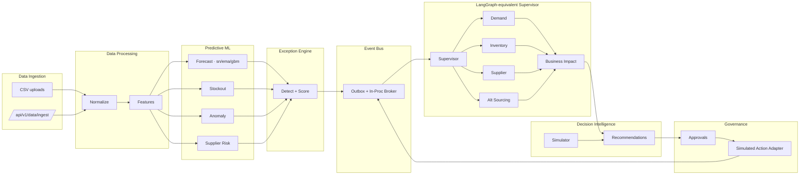
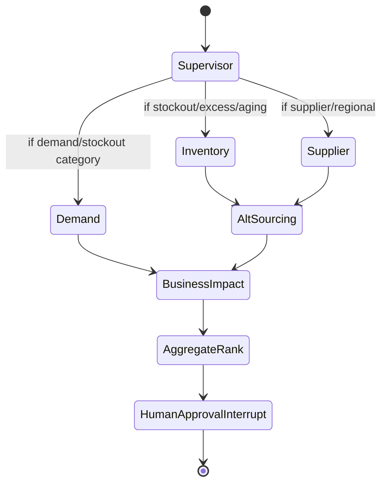
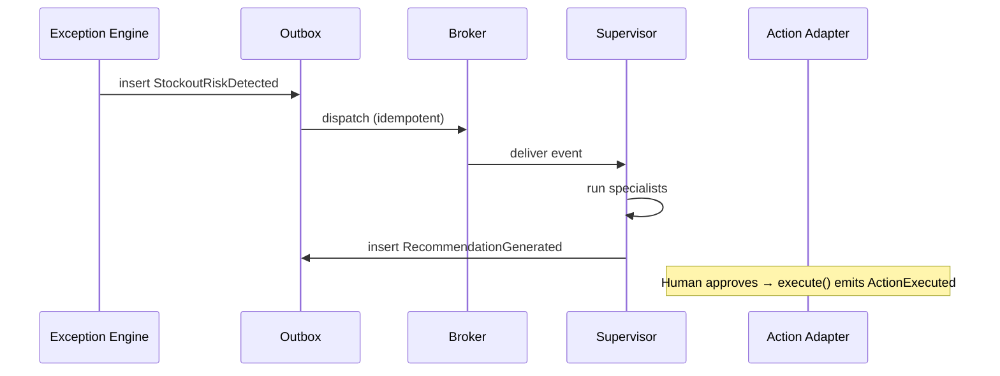

# Architecture

See [`ARCHITECTURE.html`](ARCHITECTURE.html) for the rendered diagrammed version.

## Layered diagram (Mermaid)

## LangGraph-equivalent orchestrator

## Event flow

---
*Author: **Pradeep Sahoo**.*
